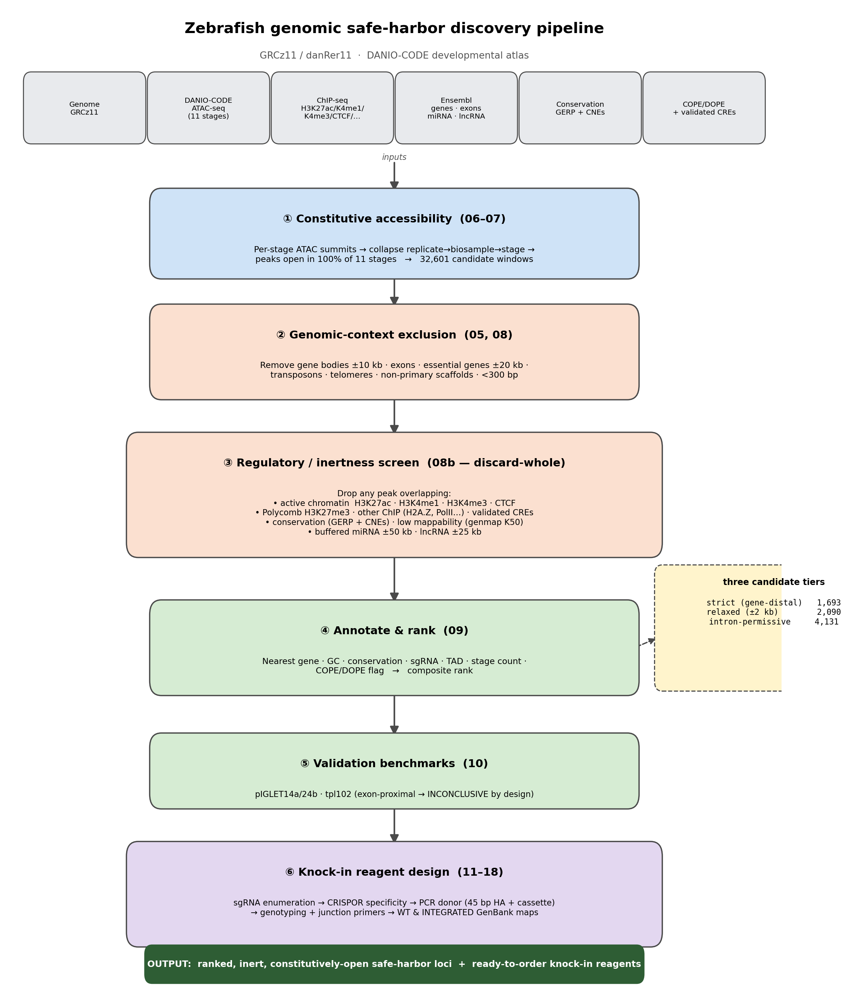

# Pipeline overview

Zebrafish genomic safe-harbor discovery pipeline (GRCz11 / danRer11), built on
the DANIO-CODE developmental atlas. The goal: find genomic loci that are
**constitutively open** (accessible across development), **inert** (no regulatory
chromatin), **safe** (far from genes/essential features), and **targetable**
(unique, CRISPR-tractable) — then generate ready-to-order knock-in reagents.

Rendered figure: [`results/pipeline_schematic.png`](../results/pipeline_schematic.png)
(regenerate with `python3 scripts/19_pipeline_figure.py`).

## Flowchart

```mermaid
flowchart TD
    subgraph IN[" Inputs "]
      direction LR
      G[Genome<br/>GRCz11]
      A[DANIO-CODE ATAC-seq<br/>11 dev. stages]
      Ch[ChIP-seq<br/>H3K27ac/K4me1/K4me3/CTCF/…]
      En[Ensembl<br/>genes · exons · miRNA · lncRNA]
      Cn[Conservation<br/>GERP + Ancora CNEs]
      Cd[COPE/DOPE<br/>+ validated CREs]
    end

    IN --> P2

    P2["① Constitutive accessibility &nbsp;(06–07)<br/><small>per-stage ATAC summits → collapse replicate→biosample→stage →<br/>peaks open in 100% of 11 stages → <b>32,601</b> windows</small>"]
    P3a["② Genomic-context exclusion &nbsp;(05, 08)<br/><small>remove gene bodies ±10 kb · exons · essential ±20 kb ·<br/>transposons · telomeres · non-primary scaffolds · &lt;300 bp</small>"]
    P3b["③ Regulatory / inertness screen &nbsp;(08b — discard-whole)<br/><small>drop peaks overlapping active ChIP · Polycomb H3K27me3 · other ChIP ·<br/>validated CREs · conservation (GERP+CNE) · low mappability (genmap K50) ·<br/>buffered miRNA ±50 kb · lncRNA ±25 kb</small>"]
    P4["④ Annotate & rank &nbsp;(09)<br/><small>nearest gene · GC · conservation · sgRNA · TAD · stage count ·<br/>COPE/DOPE flag → composite rank</small>"]
    P5["⑤ Validation benchmarks &nbsp;(10)<br/><small>pIGLET14a/24b · tpl102 — exon-proximal, INCONCLUSIVE by design</small>"]
    P6["⑥ Knock-in reagent design &nbsp;(11–18)<br/><small>sgRNA enumeration (11) → autonomous local off-target screen (11b, bwa/exon-aware)<br/>→ PCR donor (45 bp HA + cassette) → genotyping + junction primers → WT & INTEGRATED GenBank maps<br/>(CRISPOR MIT/CFD optional via 15/16)</small>"]
    OUT([OUTPUT: ranked, inert, constitutively-open safe-harbor loci<br/>+ ready-to-order knock-in reagents])

    T["<b>three candidate tiers</b><br/>strict (gene-distal) 1,693<br/>relaxed (±2 kb) 2,090<br/>intron-permissive 4,131"]

    P2 --> P3a --> P3b --> P4 --> P5 --> P6 --> OUT
    P4 -.-> T

    classDef acc fill:#CFE3F7,stroke:#4A4A4A;
    classDef exc fill:#FBE0D0,stroke:#4A4A4A;
    classDef rnk fill:#D6ECD3,stroke:#4A4A4A;
    classDef des fill:#E3D7F0,stroke:#4A4A4A;
    classDef tier fill:#FFF4CC,stroke:#4A4A4A,stroke-dasharray:4 3;
    classDef out fill:#2E5D34,color:#fff,stroke:#2E5D34;
    class P2 acc; class P3a,P3b exc; class P4,P5 rnk; class P6 des; class T tier; class OUT out;
```

## Stage → script map

| Stage | Scripts | Key output |
|---|---|---|
| Reference & annotation | `01`–`04e` | genome index, gene/exon/ncRNA/conservation/COPE-DOPE tracks |
| Exclusion tracks | `05` | `master_exclusions{,_relaxed,_intronic}.bed` |
| Accessibility | `06`–`07` | `consensus_peaks_{80,90,100}pct.bed` |
| Safe-harbor filter | `08`, `08b` | `safe_harbors_biological_*_sized.bed` |
| Annotate & rank | `09` | `candidate_feature_table.tsv` (+ `_relaxed`, `_intronic`) |
| Validation | `10` | pIGLET / tpl102 benchmark report |
| Alternate tiers | `12`, `14` | relaxed / intron-permissive tables |
| Mappability | `13` | genmap uniqueness mask |
| Knock-in design | `15`–`18` | sgRNA shortlists, donor + genotyping + junction primers, GenBank maps |
| Schematic | `19` | this figure |
